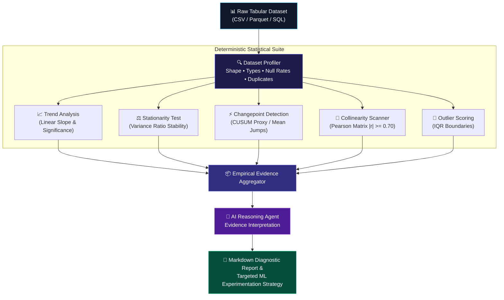

<div align="center">

# 🔬 AI Data Scientist Agent — Automated EDA & ML Discovery

**Evidence-Driven Autonomous Data Profiling, Statistical Diagnostics & ML Experimentation System**

[](https://python.org)
[](https://pandas.pydata.org)
[](https://scikit-learn.org)
[](LICENSE)
[]()

</div>

---

## 📌 Executive Overview

Data scientists spend up to 80% of their initial time cleaning data, profiling distributions, and checking for statistical violations (stationarity shifts, high multicollinearity, outlier skew).

The **AI Data Scientist Agent** is an autonomous analytics workflow that transforms raw tabular datasets into comprehensive exploratory data analysis (EDA) reports and actionable machine learning recommendations. Using an **evidence-driven architecture**, deterministic Python executors calculate exact statistical metrics (slopes, variance ratios, CUSUM changepoints, Pearson correlation matrices), passing the verifiable output to an agent reasoning engine to formulate ML recommendations without hallucination.

---

## 🏗️ Workflow Architecture



---

## 🛠️ Statistical Tool Suite

| Statistical Tool | Method / Formula | Purpose |
| :--- | :--- | :--- |
| **Trend Evaluation** | Normalized First-Order Polyfit ($\frac{m}{\sigma}$) | Flags steady drift vs stationarity |
| **Stationarity Assessment** | Split-Half Variance Ratio ($\frac{\sigma_2^2}{\sigma_1^2}$) | Evaluates volatility regime changes |
| **Changepoints** | Z-score deviation on first differences | Detects abrupt structural shifts or sensor resets |
| **Multicollinearity** | Pearson Correlation Matrix | Flags redundant feature pairs for PCA/pruning |
| **Outlier Scoring** | $Q_1 - 1.5 \times \text{IQR} \dots Q_3 + 1.5 \times \text{IQR}$ | Isolates non-Gaussian spikes |

---

## 🚀 Quickstart & Usage

### 1. Installation

```bash
git clone https://github.com/B-LIPIKA/AI-Data-Scientist-Agent.git
cd AI-Data-Scientist-Agent

python -m venv .venv
source .venv/bin/activate  # On Windows: .venv\Scripts\activate

pip install -r requirements.txt
```

### 2. Run Test Suite

```bash
pytest tests/ -v
```

### 3. Run Automated Profiling via CLI

```bash
python cli.py
```

### 4. Python API Usage

```python
import pandas as pd
from agent.eda_agent import AIDataScientistAgent

# Load your dataset
df = pd.read_csv("your_data.csv")

# Initialize and run agent
agent = AIDataScientistAgent()
result = agent.analyze_dataset(df, dataset_name="Turbine_Sensors")

# Print executive report
print(result["markdown_report"])
```

---

## 📂 Project Structure

```
├── agent/
│   └── eda_agent.py              # Autonomous AI agent orchestrator & synthesizer
├── profiler/
│   ├── dataset_profiler.py       # Base schema, null rates, and memory inspection
│   └── statistical_tools.py      # Deterministic stats (trend, stationarity, anomalies)
├── tests/
│   └── test_data_scientist_agent.py # Unit test suite
├── cli.py                        # Command line demonstration runner
├── requirements.txt              # Project dependencies
└── README.md                     # Documentation
```

---

## 📜 License
Distributed under the MIT License. See `LICENSE` for details.

## 👤 Author
**B. Lipika**  
- Machine Learning Engineer | AIML Trainee @ Tiny Prism Labs
- [LinkedIn Profile](https://linkedin.com/in/lipika2004)
- [GitHub Profile](https://github.com/B-LIPIKA)
